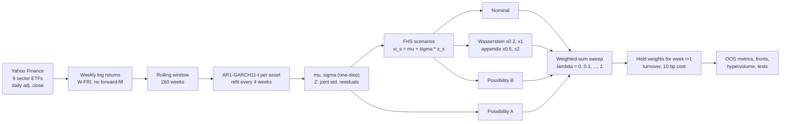

# Robust Portfolio Optimization under Uncertainty

Experiment 1 compares four ways of handling **forecast uncertainty** in a bi-objective
(expected loss vs. CVaR) portfolio problem. All four use the **same** AR(1)–GARCH(1,1)-t
forecasts and the same scenarios. The only thing that changes between them is the
ambiguity model:

| Model | Uncertainty set around the forecast |
|---|---|
| **Nominal** | none: trust the empirical scenario distribution |
| **Wasserstein** | W1 ball of radius ε around the empirical residual distribution |
| **Possibility A** | elliptical (multivariate-t) possibility distribution, closed form |
| **Possibility B** | nested empirical α-cuts over the scenarios, LP form |

Run instructions and output files are described in [`exp1/README.md`](exp1/README.md) (in Thai).

---

## 1. Pipeline



At each decision date *i* (end of week *i*), the model uses only returns
r<sub>i−259</sub> … r<sub>i</sub>. The resulting portfolio is held over week *i+1*.

## 2. Data

- **Universe:** 9 Select Sector SPDR ETFs: XLB, XLE, XLF, XLI, XLK, XLP, XLU, XLV, XLY.
  XLRE and XLC are excluded because their history is too short.
- **Period:** 1999-01-01 → 2026-10-30, using the last trading day of each week (`W-FRI`).
- **Returns:** weekly log returns are used for model fitting. Realized P&L uses simple returns.
- **Ingestion:** each ticker is downloaded and validated separately, and the cache is
  written atomically. Prices are never forward-filled. See `exp1/src/data.py`.

## 3. Forecasting model (`forecast.py`)

Each asset *j* gets its own AR(1)–GARCH(1,1) model with standardized Student-t innovations.
Returns are scaled ×100 before fitting:

$$
r_{t,j} = c_j + \phi_j r_{t-1,j} + \varepsilon_{t,j},\qquad
\varepsilon_{t,j} = \sigma_{t,j} z_{t,j},\qquad z_{t,j}\sim t_{\nu_j}\ (\text{unit variance})
$$

$$
\sigma^2_{t,j} = \omega_j + a_j\varepsilon^2_{t-1,j} + b_j\sigma^2_{t-1,j}
$$

- Parameters are re-estimated every 4 decisions (warm-started from the previous fit). If a
  fit fails or becomes non-stationary (a + b ≥ 0.9999), the previous parameters are kept.
  The filter still runs on the newest data every week.
- **Outputs per decision:** the one-step mean μ ∈ ℝ<sup>d</sup>, the volatility σ ∈ ℝ<sup>d</sup>,
  the degrees of freedom ν ∈ ℝ<sup>d</sup>, and the **joint** standardized residual matrix
  Z ∈ ℝ<sup>N×d</sup>. Each row of Z comes from a single week, so cross-asset dependence is kept.
- **Filtered historical simulation (FHS) scenarios:**
  $\xi_s = \mu + \sigma \odot z_s$, with scenario loss $L_s(w) = -\xi_s^\top w$.

## 4. Optimization problem (`optimize.py`)

Long-only, fully invested: $w \in \Delta = \{w \ge 0,\ \mathbf 1^\top w = 1\}$.
Each model *k* defines a worst-case **expected loss** F<sub>1</sub> and a worst-case
**CVaR<sub>α</sub>** of loss F<sub>2</sub>, with α = 0.05. The Pareto front is traced by a weighted-sum sweep:

$$
w^*_\lambda = \arg\min_{w\in\Delta}\ \lambda F_1^{(k)}(w) + (1-\lambda) F_2^{(k)}(w) + 10^{-6}\lVert w\rVert_2^2,
\qquad \lambda \in \{0, 0.1, \dots, 1\}
$$

The ridge term makes the solution unique. Headline tables report λ = 0.5.

### 4.1 Nominal
Uses the empirical mean and CVaR over the N scenarios, with CVaR in Rockafellar–Uryasev LP form:

$$
F_1 = \tfrac1N\textstyle\sum_s L_s(w),\qquad
F_2 = \min_\eta\ \eta + \tfrac{1}{\alpha N}\textstyle\sum_s (L_s(w)-\eta)_+
$$

### 4.2 Wasserstein DRO
This model uses a W1 ball of radius ε around the empirical residual distribution, with an
ℓ2 ground metric in residual space and unbounded support. That gives a closed-form penalty:

$$
F_1 = \hat E[L] + \varepsilon\,\lVert \sigma\odot w\rVert_2,\qquad
F_2 = \widehat{\mathrm{CVaR}}_\alpha[L] + \tfrac{\varepsilon}{\alpha}\,\lVert \sigma\odot w\rVert_2
$$

**Radius:** ε = scale × ε₀. Here ε₀ is the 95% quantile of the exact W1 distance between Z and
B = 100 stationary-bootstrap resamples of Z. The bootstrap uses a mean block length of 4 weeks,
and W1 is solved exactly as an assignment problem (`ambiguity.eps_base`). The main scales are
×0.2 and ×1, and the appendix scales are ×0.5 and ×2. Nominal is the special case ε = 0.

### 4.3 Possibility A: elliptical
The forecast distribution is treated as elliptical, with Σ = D S D. Here D = diag(σ) and S is
the residual correlation/covariance. This gives:

$$
F_1 = -\mu^\top w + \kappa_E \lVert S^{1/2} D w\rVert_2,\qquad
F_2 = -\mu^\top w + \kappa_C \lVert S^{1/2} D w\rVert_2
$$

The κ constants come from the squared Mahalanobis radius of a standardized multivariate t,
$M = \tfrac{\nu-2}{\nu}\, d\, F(d,\nu)$, using ν = median of the per-asset ν:

$$
\kappa_E = E[\sqrt M],\qquad \kappa_C = \mathrm{CVaR}_\alpha(\sqrt M)\ \ (\text{upper tail})
$$

They are computed on a deterministic quantile grid of 400,000 points (`kappas_elliptical`).

### 4.4 Possibility B: scenario α-cuts
1. Rank the scenarios by Mahalanobis distance from the forecast (z = 0).
2. Build nested cuts C<sub>k</sub> = the ⌈(1−γ<sub>k</sub>)N⌉ most central scenarios,
   for γ ∈ {0.05, …, 0.95}.
3. A probability vector p over the scenarios is admissible iff p(C<sub>k</sub>) ≥ 1 − γ<sub>k</sub>
   for every k. In matrix form: $A p \ge b$.

The worst case over admissible p is dualized into an LP (DPP form in CVXPY):

$$
F_1 = \min_{t,\,y\ge0}\ t - b^\top y \quad \text{s.t. } t\mathbf 1 - A^\top y \ge L(w)
$$

$$
F_2 = \min_{\eta,\,t,\,y\ge0}\ \eta + \tfrac{1}{\alpha}(t - b^\top y) \quad
\text{s.t. } t\mathbf 1 - A^\top y \ge L(w) - \eta\mathbf 1,\ \ t\mathbf 1 - A^\top y \ge 0
$$

### 4.5 Solver
All problems are written in CVXPY with **parameters in DPP form**, so each one is compiled
once and then re-solved for every (date, λ) with **Clarabel**. If a solve fails, the model
falls back to the previous week's weights (or 1/N at the start) and records the failure in
`bad_solves`.

## 5. Backtest (`backtest.py`)

- Rolling origin: every model sees exactly the same forecasts and scenarios.
  ε₀, κ<sub>E</sub> and κ<sub>C</sub> are updated together with the GARCH refits.
- The weights chosen at the end of week *i* earn the simple returns of week *i+1*.
- **Turnover** is measured against the *drifted* previous weights.
  **Net return** = gross − 10 bp × turnover (one-way).
- Benchmark: **1/N**, rebalanced weekly under the same cost model.

## 6. Evaluation (`metrics.py`)

| What | How |
|---|---|
| Performance at λ = 0.5 | annualized return/vol, Sharpe, max drawdown, CVaR<sub>5%</sub>, turnover |
| Out-of-sample Pareto front | (mean loss, CVaR) of the realized returns for each λ, keeping non-dominated points |
| Front quality | 2-D **hypervolume** in min–max normalized space, reference point (1.1, 1.1) |
| HV significance | stationary block bootstrap CI of the HV difference vs. Nominal (B = 500, block 8) |
| Sharpe significance | Ledoit–Wolf HAC test of the Sharpe difference, with **Holm** correction |
| Stress regimes | CVaR inside GFC, Euro debt crisis, COVID and the 2022 bear market (dates fixed in advance) |

## 7. Pre-registration

Every setting that can change results lives in `exp1/src/config.py` (a frozen dataclass)
and was committed **before** the out-of-sample run (`c6f84c1`). Each run writes the git
commit and a config fingerprint to `results/real/run_meta.json`. The `--synthetic` mode is
for testing the code only.

## 8. Code map

```
exp1/src/
├── config.py       frozen experiment settings (pre-registration)
├── data.py         download / validate / weekly log returns
├── forecast.py     AR(1)-GARCH(1,1)-t per asset, FHS residuals
├── ambiguity.py    Wasserstein radius, Possibility-A kappas, Possibility-B cuts
├── optimize.py     the four CVXPY models (DPP, compiled once)
├── backtest.py     rolling-origin backtest, turnover, costs
├── metrics.py      Sharpe/MDD/CVaR, hypervolume, bootstrap CI, HAC, Holm
├── run_exp1.py     full experiment → results/real/
├── exp1_mini.py    demo figure
├── posthoc_front_diagnostics.py   post-hoc (not pre-registered) front checks
└── tests.py, test_data.py         correctness tests
```
